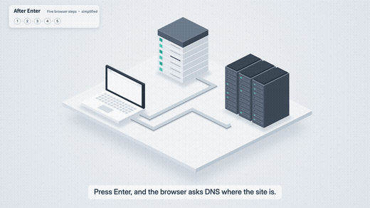
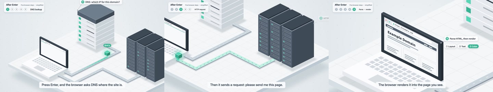

<a href="https://motiongit.com/@curious-atlas/knowledge-explainer-isometric"></a>

# Isometric System · Technical Explainer

Break down systems and processes with isometric diagrams and visible connections.

**16:9 · 1920 × 1080 · 19.614s · 60 fps** &nbsp; / &nbsp; [@curious-atlas](https://motiongit.com/@curious-atlas)

[**Get this template on MotionGit ↗**](https://motiongit.com/@curious-atlas/knowledge-explainer-isometric) · [简体中文](README.zh-CN.md)

> Demo live · template download coming soon. Check the live page for availability. Register/sign in and obtain your own .motion when download opens.

## Demo

[](https://motiontemplates.github.io/632629/)

[Watch the original demo](https://media.openaicut.com/previews/597/draft-en-17ed9e453686.mp4)



## What to prepare

- **Required:** Sourceedits: content items, at most 256 items.
- **Required:** Voiceover: text, up to 240 characters.
- **Required:** Duration: number.
- **Required:** Map: content items, at least 2 items, at most 1000 items.
- **Required:** Captions: content items, at most 256 items.

Reuse the existing scene structure, diagram motion, palette and typography with the user's own accurate facts..

## Let your assistant guide you

Send the repository URL and this request to Codex, Doubao or another assistant:

```text
https://github.com/motiontemplates/632629
Guide me to make a video with this template. Help me prepare the materials and get my .motion from MotionGit, then check the actual package's dependencies and show a plan and preview before rendering.
```

**For assistants:** read [the production handoff](ASSISTANT.md). Guide the user to the exact MotionGit page above to obtain the real package. While download is pending, help prepare the brief and materials.

## Production setup

- The package declares a Python and Node.js host. Check its dependency lock for supported versions and any additional rendering tools.
- Use the package dependency lock and setup/check instructions. Check existing tools first, install only missing requirements and verify a preview.

First-time setup can take a while. Have the assistant check existing tools, install only missing requirements, verify a short preview, and reuse the environment next time.

## About .motion

MP4 is the finished video. **.motion is the reusable template**: it brings together the animation project, content slots, materials, dependencies and instructions so you can create again with your own content. [Format specification ↗](https://motiongit.com/spec)

MotionGit also supports asset matching, image generation, voiceover and music search where appropriate, subject to the actual template slots, account access and pricing.

---

This repository contains the introduction and public demo. Get the actual template for production on [MotionGit](https://motiongit.com/@curious-atlas/knowledge-explainer-isometric).
